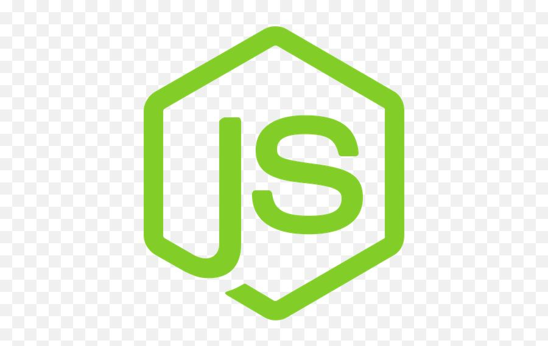

<p align="center">
  
</p>
   
---

# JavaScript Node.js Algorithms

A collection of JavaScript algorithm examples designed to practice programming logic, problem-solving, and fundamental algorithmic concepts using Node.js.

## Introduction

This repository provides practical implementations of common algorithms using JavaScript. The examples cover mathematical calculations, string operations, array manipulation, sorting, and searching.

The purpose is to build a stronger understanding of JavaScript fundamentals and develop problem-solving skills through simple, executable code examples.

## Algorithms Covered

The repository includes 15 algorithm examples:

1. **Factorial of a Number** — Calculate a number's factorial using recursion.
2. **Fibonacci Sequence** — Generate Fibonacci numbers using a loop.
3. **Prime Number Checker** — Determine whether a number is prime.
4. **Palindrome Checker** — Check whether a string reads the same forward and backward.
5. **Sum of an Array** — Calculate the sum of array elements using `reduce()`.
6. **Reverse an Array** — Reverse the order of array elements.
7. **Find Maximum in an Array** — Find the largest value using `Math.max()`.
8. **Find Minimum in an Array** — Find the smallest value using `Math.min()`.
9. **Bubble Sort** — Sort array elements using the bubble sort algorithm.
10. **Linear Search** — Find a target value through sequential searching.
11. **Binary Search** — Search for a target value in a sorted array.
12. **Count Occurrences in an Array** — Count how many times a value appears.
13. **Remove Duplicates from an Array** — Remove repeated values using `Set`.
14. **Merge Two Arrays** — Combine arrays using the spread operator.
15. **Even or Odd Checker** — Determine whether a number is even or odd.

## Technologies Used

- JavaScript (ES6+)
- Node.js
- JavaScript Functions
- Arrays and Strings
- Loops and Conditional Statements
- Recursion
- Array Methods
- Built-in JavaScript Objects and Methods

## Repository Structure

```text
javascript-node-js-algorithms/
├── javascript.js
└── README.md
```

## How to Run

**Prerequisite:** Install [Node.js](https://nodejs.org/).

1. Clone the repository:

   ```bash
   git clone https://github.com/aminbiography/javascript-node-js-algorithms.git
   ```

2. Navigate to the project directory:

   ```bash
   cd javascript-node-js-algorithms
   ```

3. Run the JavaScript file:

   ```bash
   node javascript.js
   ```

The algorithm examples and their sample outputs will run in the terminal.

---

<h1>Node.js</h1>


```
// Node.js Algorithms

// 1. Factorial of a Number
function factorial(n) {
    if (n === 0 || n === 1) return 1;
    return n * factorial(n - 1);
}
console.log(factorial(5)); // 120

// 2. Fibonacci Sequence
function fibonacci(n) {
    let a = 0, b = 1;
    let result = [];
    while (n > 0) {
        result.push(a);
        [a, b] = [b, a + b];
        n--;
    }
    return result;
}
console.log(fibonacci(10)); // [0, 1, 1, 2, 3, 5, 8, 13, 21, 34]

// 3. Prime Number Checker
function isPrime(num) {
    if (num <= 1) return false;
    for (let i = 2; i <= Math.sqrt(num); i++) {
        if (num % i === 0) return false;
    }
    return true;
}
console.log(isPrime(7)); // true

// 4. Palindrome Checker
function isPalindrome(str) {
    let cleanedStr = str.replace(/[^a-z0-9]/gi, '').toLowerCase();
    let reversedStr = cleanedStr.split('').reverse().join('');
    return cleanedStr === reversedStr;
}
console.log(isPalindrome('racecar')); // true

// 5. Sum of an Array
function sumArray(arr) {
    return arr.reduce((acc, curr) => acc + curr, 0);
}
console.log(sumArray([1, 2, 3, 4])); // 10

// 6. Reverse an Array
function reverseArray(arr) {
    return arr.reverse();
}
console.log(reverseArray([1, 2, 3, 4])); // [4, 3, 2, 1]

// 7. Find Maximum in an Array
function findMax(arr) {
    return Math.max(...arr);
}
console.log(findMax([1, 2, 3, 4, 5])); // 5

// 8. Find Minimum in an Array
function findMin(arr) {
    return Math.min(...arr);
}
console.log(findMin([1, 2, 3, 4, 5])); // 1

// 9. Bubble Sort
function bubbleSort(arr) {
    let n = arr.length;
    for (let i = 0; i < n-1; i++) {
        for (let j = 0; j < n-i-1; j++) {
            if (arr[j] > arr[j+1]) {
                [arr[j], arr[j+1]] = [arr[j+1], arr[j]];
            }
        }
    }
    return arr;
}
console.log(bubbleSort([5, 3, 8, 1, 2])); // [1, 2, 3, 5, 8]

// 10. Linear Search
function linearSearch(arr, target) {
    for (let i = 0; i < arr.length; i++) {
        if (arr[i] === target) return i;
    }
    return -1; // not found
}
console.log(linearSearch([1, 2, 3, 4, 5], 3)); // 2

// 11. Binary Search
function binarySearch(arr, target) {
    let left = 0, right = arr.length - 1;
    while (left <= right) {
        let mid = Math.floor((left + right) / 2);
        if (arr[mid] === target) return mid;
        if (arr[mid] < target) left = mid + 1;
        else right = mid - 1;
    }
    return -1; // not found
}
console.log(binarySearch([1, 2, 3, 4, 5], 3)); // 2

// 12. Count Occurrences in Array
function countOccurrences(arr, val) {
    return arr.filter(item => item === val).length;
}
console.log(countOccurrences([1, 2, 3, 3, 3, 4], 3)); // 3

// 13. Remove Duplicates from an Array
function removeDuplicates(arr) {
    return [...new Set(arr)];
}
console.log(removeDuplicates([1, 2, 2, 3, 4, 4])); // [1, 2, 3, 4]

// 14. Merge Two Arrays
function mergeArrays(arr1, arr2) {
    return [...arr1, ...arr2];
}
console.log(mergeArrays([1, 2], [3, 4])); // [1, 2, 3, 4]

// 15. Check if a Number is Even or Odd
function isEven(num) {
    return num % 2 === 0;
}
console.log(isEven(4)); // true
console.log(isEven(5)); // false
```

---

## Learning Objectives

- Practice JavaScript programming fundamentals.
- Understand recursion and iteration.
- Work with arrays and strings.
- Apply sorting and searching techniques.
- Use JavaScript built-in methods and operators.
- Improve logical thinking and algorithmic problem-solving.

## Purpose

This repository is maintained as a learning and practice resource for JavaScript and Node.js. It provides simple examples for exploring algorithms and strengthening foundational programming skills.

## Author

**Mohammad Aminul Islam**

---

#JavaScript #NodeJS #NodeJSAlgorithms #JavaScriptAlgorithms #Algorithms #ProblemSolving #CodingPractice #JavaScriptBasics #ES6 #ArrayMethods #SortingAlgorithms #SearchingAlgorithms #Recursion #ProgrammingFundamentals #LearnJavaScript
